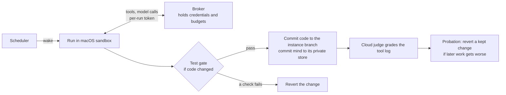

# SHAFT

Persistent, self-modifying AI agents that live on your Mac. Each agent keeps its own memory, sets its own goals,
rewrites its own code, and talks with you. A supervisor that the agents cannot change runs them in macOS sandboxes,
holds every credential, tests each change they make to themselves, and has other models grade their work from what they
actually did, not from what they say they did.

SHAFT is a research project about one question: can an agent improve itself over weeks of unattended work without
breaking its own rails? Everything it does is recorded so you can check.

By Daniele Grassi. [MIT licensed](LICENSE).

## Status

- **Personal research project.** The author runs it every day on one Mac mini, with several agents on cloud and local
  models. Interfaces, defaults and model dependencies change often; the [release tags](https://github.com/dgrassi1984/shaft/tags) say what changed.
- **macOS only.** It relies on `sandbox-exec`, `launchd` and, for local models, Apple Silicon.
- **Expect breakage.** Start with one agent, talk to it, run a few cycles by hand, and read what it did before you let
  it run on its own.
- **A clone gives you SHAFT, not anyone's agents.** GitHub holds the supervisor (`main`) and the starting agent code
  (`template`). Agents you create exist only on your Mac.

> [!WARNING]
> Agents run code they wrote themselves and can reach the public internet. Anything you let an agent read (a shared
> folder, mail labels, calendars, Drive files) can leave your Mac, including through instructions hidden in that
> material. Cloud calls cost money, and the spending caps are checks made before work starts, not billing limits. Read
> [SECURITY.md](SECURITY.md) before you grant any access.

## How it works



1. The **scheduler** wakes each agent on its interval (every 2 hours by default, sooner for a message or a promise
   that falls due) and runs its **sleep** once a day from 04:00, when it consolidates memory, personality and goals.
2. In a **cycle**, the agent declares a goal, a success criterion and predictions, then works through tools. It runs
   under `sandbox-exec`. Every tool call and model call goes through the **broker**, which holds the API keys and
   enforces per-run limits. The agent never sees a key.
3. When the run ends, the supervisor checks the agent's journal and core personality. If the agent changed its code,
   plugins or configuration, the **test gate** runs the supervisor's invariant tests and the agent's own tests. A
   failed check reverts the change.
4. Code is committed to the agent's git branch. Memory, notes and self-description go to a separate, local-only **mind
   store**, kept out of the code branches.
5. **Cloud judges** (models other than the agent's own) grade sampled cycles from the recorded tool log. A kept change
   stays on **probation** for its next judged cycles and is reverted if the work gets worse.

The [architecture](docs/architecture.md) covers the layout, the evaluation design and why code and memory are kept
apart. The rules the supervisor enforces are in [safety](docs/safety.md).

## Concepts

| Term | Meaning |
|---|---|
| Instance | One agent: a branch `instance/<name>`, a worktree `instances/<name>/`, and a private mind store. |
| Template | The starting agent code on the `template` branch. New instances are made from it; `shaft update` merges later fixes. |
| Supervisor | The trusted side (`supervisor/`, Python standard library): scheduling, sandbox, broker, gate, judges, services. |
| Broker | A per-run local server that gives the instance its tools and model calls and keeps credentials out of its reach. |
| Cycle, sleep | An autonomous work session; the daily consolidation run. |
| Mind store | A local git repository with no remote that versions an instance's memory, notes and self-description. |
| Drive | `drive.md`: what the instance is for, in the operator's words. Only the operator changes it. Not Google Drive. |
| Test gate | The tests a self-change must pass before it is kept. |
| Judge | A different model that grades a cycle from the tool log, separately from the instance's own report. |
| Probation | The judged cycles after a kept change during which a decline reverts it. |
| Trial | A replay of past cycles with and without a proposed change, judged blind, before the instance adopts it. |
| Battery | A periodic set of held-out tasks, run against a blank copy of the template on the same model as a control. |
| Consult | An instance asking another model for a second opinion, under its own daily budget. |

## Requirements

- macOS with `sandbox-exec` and a logged-in user session (the services are `launchd` agents).
- Python 3.12 or later as `python3`, git, and `uv` on your PATH (`brew install python@3.12 uv`). The scheduler, API,
  web and Telegram services record the absolute path of the Python that installed them; the model and embedding
  services run `.venv-bonsai`'s Python. If either moves, run that service's `on` command again.
- Git `user.name` and `user.email` set: creating an instance makes commits.
- For the cloud-only quickstart: an Anthropic API key and an OpenRouter API key.
- Optional: Apple Silicon and an MLX model pack for [local models](docs/local-model.md) (the defaults assume 64 GB of
  memory); Tailscale for the [web UI and API](docs/web-and-api.md); Google OAuth clients, a Telegram bot or the shared
  Chromium for [integrations](docs/integrations.md); Xcode and your own Apple Developer team for the
  [native apps](apps/shaft/README.md).

**Costs.** Each instance has daily checks per category: $8 for its cloud model, $5 for coding hand-offs, $3 for
consultations and $3 for its own trials (`bin/shaft settings` changes them). Judging has no cap, only an alert at $3 a
day. What a cycle costs depends mostly on the model. [Configuration](docs/configuration.md) lists every limit.

## Quickstart: cloud-only

This path needs no local model, only cloud API keys.

1. Clone the repository with its `template` branch, and restore the worktrees:

   ```bash
   git clone https://github.com/dgrassi1984/shaft.git
   cd shaft
   bin/shaft setup
   git show-ref --verify refs/heads/template
   ```

   `setup` restores worktrees for existing local or `origin` branches; it does not create a template or an instance
   from nothing. If the last command fails, the clone lacks the `template` branch and you cannot create instances.
   `setup` also installs a `pre-push` hook that refuses to push `instance/*` branches, because their history can hold an
   instance's private data. If another tool already owns that hook, `setup` exits with
   status 1; add SHAFT's refusal to your hook yourself.

   Optionally, put the launcher on your PATH (this guide keeps using `bin/shaft`):

   ```bash
   mkdir -p ~/.local/bin && ln -s "$PWD/bin/shaft" ~/.local/bin/shaft
   ```

2. Copy the secrets template and fill in your keys:

   ```bash
   cp .env.example .env
   ```

   Set `ANTHROPIC_API_KEY` for the instance's model below and `OPENROUTER_API_KEY` for the judges (every default judge
   is an OpenRouter model, as are consultations). `SCRAPEBADGER_API_KEY` is optional, for web search. Never put a
   secret in an instance's config.

3. Install the terminal client's dependencies:

   ```bash
   python3 -m venv .venv-ui
   .venv-ui/bin/python -m pip install -r requirements-ui.txt
   ```

   Without them, `talk` falls back to plain line mode.

4. Create an instance (any lowercase name) and point it at a cloud model through the broker:

   ```bash
   bin/shaft new example
   bin/shaft config example set OPERATOR_NAME="Your Name" LLM_BASE_URL=broker LLM_MODEL=claude-haiku-5-5
   ```

   This edits `instances/example/config.env`. Leave `LLM_API_KEY` empty: the broker adds the key. The name is optional
   (empty means "the operator"). The model is an example; [configuration](docs/configuration.md) lists the routes. The
   template's default points at the local model server, so do not skip this step.

5. Talk to it:

   ```bash
   bin/shaft talk example
   ```

   Leave with `/exit` or Ctrl-D. Run one autonomous cycle by hand with `bin/shaft live example`, then see what it did
   with `bin/shaft status example` or in the control panel, `bin/shaft top`.

6. When you are ready for unattended work and spending, start the scheduler:

   ```bash
   bin/shaft autonomy on
   bin/shaft autonomy status
   ```

   `bin/shaft autonomy off` stops it. `bin/shaft pause example` pauses one instance, `bin/shaft kill example` also
   stops what it is running, and `bin/shaft delete example` removes it (archived first).

## Talking to an instance

- **Terminal:** `bin/shaft talk <name>`, and the `bin/shaft top` control panel.
- **Web UI and PWA** for iPhone and iPad, an OpenAI-compatible chat API and an inbox endpoint, all on your tailnet
  only: [web UI and API](docs/web-and-api.md).
- **Native iOS, iPadOS and macOS apps** over the same tailnet: [apps](apps/shaft/README.md), with the
  [app API contract](docs/app-api.md).
- **Telegram:** [integrations](docs/integrations.md).

## Optional features

- **Local and self-hosted models**, and routing through a Codex or Grok plan: [local models](docs/local-model.md).
- **Access grants**: read-only Gmail labels, calendars (changes that involve other people wait for your approval),
  Drive; instance-owned Google accounts; scheduled jobs; images; a shared Chromium: [integrations](docs/integrations.md).
- **Evaluation**: trials, the capability battery, model bake-offs and measurement reports:
  [command reference](docs/cli.md).

## Configuration

The root `.env` holds the supervisor's credentials. `bin/shaft settings` shows and changes supervisor settings
(environment first, then `.supervisor/settings.env`, then the default); `bin/shaft config <name>` changes an instance's
`config.env`. Long-running services need a restart to pick up a saved change. Every setting and its default is in
[configuration](docs/configuration.md).

## Backups and moving to a new Mac

Your instances live only on your Mac: their branches, their mind stores under `.supervisor/minds/`, their ignored files,
and the supervisor's state and credentials. To move a setup, stop it, copy the whole project folder and reinstall the
services, as [moving SHAFT to a new Mac](docs/migration.md) describes, including what to back up.

## Documentation

| Document | What it covers |
|---|---|
| [Architecture](docs/architecture.md) | How the pieces fit, the evaluation design, code and memory kept apart |
| [Safety](docs/safety.md) | Every rule the supervisor enforces |
| [Command reference](docs/cli.md) | All `shaft` commands |
| [Configuration](docs/configuration.md) | Every setting and its default |
| [Web UI and API](docs/web-and-api.md) | Terminal client, web UI/PWA, chat API, inbox |
| [App API](docs/app-api.md) | The `/app/v1` contract the native apps use |
| [Native apps](apps/shaft/README.md) | Building, signing and installing the iOS and macOS apps |
| [Integrations](docs/integrations.md) | Telegram, Google mail/calendar/Drive, jobs, images, browser |
| [Local models](docs/local-model.md) | Local MLX model, self-hosted servers, Codex and Grok plans |
| [Moving to a new Mac](docs/migration.md) | Backup and migration |
| [Deploying a release](docs/deploy.md) | The maintainer's runbook for updating a running setup |
| [Design plans](docs/plans/PLAN.md) | Dated design records; their status lines describe the plan when it was written |
| [Model bake-offs](docs/bakeoffs/README.md) | How models are compared for an instance, and the results |
| [Security policy](SECURITY.md) | Threat model and how to report a vulnerability |

## Development

```bash
bin/shaft setup
python3 -m unittest discover -s supervisor/tests -t .
```

The native apps' Swift package has its own tests (`cd apps/shaft/Packages/SHAFTKit && swift test`). Read
[CONTRIBUTING.md](CONTRIBUTING.md) before opening a pull request; coding agents should read [AGENTS.md](AGENTS.md).

## Citing and license

GitHub's "Cite this repository" button uses [CITATION.cff](CITATION.cff). Copyright Daniele Grassi, released under the
[MIT License](LICENSE).
